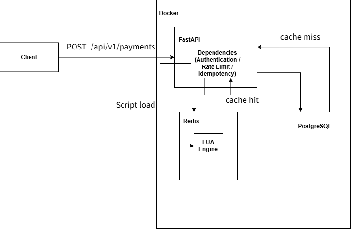

# Idempotency + Sliding-Window Rate Limiting Gateway

A high-concurrency payment API gateway built with **FastAPI**, **Redis**, and **PostgreSQL**, focusing on atomic idempotency (preventing double charges under concurrent requests) and sliding-window rate limiting.

## Overview

- **Containerized Environment:** Orchestrates PostgreSQL, Redis, and FastAPI via Docker Compose with strict health checks, startup dependencies, and CPU/memory resource limits.
- **Atomic Execution via Redis Lua Scripting:** Combines idempotency key lookup, SHA-256 payload hash validation, and distributed lock acquisition into single atomic operations to eliminate race conditions (TOCTOU). Uses Redis Sorted Sets (`ZSET`) for precise sliding-window rate limiting per client tier (10 req/min for Standard, 100 req/min for Enterprise).
- **L2 Authentication Caching:** Caches API client credentials and tier metadata in Redis (Cache-Aside pattern) with TTL and negative caching to minimize PostgreSQL read load.

## Architecture

### Request Flow

1. **Authentication:** Validates `X-API-Key` against the Redis L2 cache. On a cache miss, queries PostgreSQL and populates Redis before proceeding.
2. **Rate Limiting:** Evaluates the client's sliding window in Redis via Lua script. Returns `429 Too Many Requests` (with `Retry-After` header) if the tier quota is exceeded.
3. **Idempotency Control:** Evaluates `Idempotency-Key` and the SHA-256 hash of the request payload atomically in Redis:
   - **New request (Cache Miss):** Acquires an `IN_PROGRESS` lock and proceeds to database settlement.
   - **Completed request (Same Payload):** Immediately returns the cached response (`200 OK` with `X-Idempotency-Replayed: true`).
   - **Payload mismatch (Same Key, Different Payload):** Rejects immediately with `422 Unprocessable Entity` to prevent parameter tampering.
   - **Concurrent in-flight request:** Rejects immediately with `409 Conflict` while the initial request is still being processed.
4. **Settlement:** Inserts a `SETTLED` transaction record into PostgreSQL (`payment_transactions`), transitions the Redis state to `COMPLETED` with the cached response payload, and returns `201 Created`.

## How to Run

### 1. Start the Services
~~~bash
cp .env.example .env # Set your own credentials in .env
docker compose up -d --build
~~~

### 2. Run Automated Verification Script
The verification script (`scripts/test_concurrency.sh`) automatically tests health checks, initial transaction creation, idempotent cache replay, payload tampering defense, 5 concurrent requests with the same key, and sliding-window rate limiting.

~~~bash
# Linux / macOS
bash scripts/test_concurrency.sh

# Windows PowerShell (using Git Bash)
& "C:\Program Files\Git\bin\bash.exe" scripts/test_concurrency.sh
~~~

### 3. Verify Database Integrity
Confirm that exactly one record was persisted despite multiple concurrent and replayed requests:

~~~bash
# Linux / macOS
docker exec -it tx_postgres psql -U tx_user -d tx_db -c \
  "SELECT idempotency_key, count(*), status FROM payment_transactions GROUP BY idempotency_key, status;"

# Windows PowerShell
docker exec -it tx_postgres psql -U tx_user -d tx_db -c "SELECT idempotency_key, count(*), status FROM payment_transactions GROUP BY idempotency_key, status;"
~~~

## AI-Assisted Workflow

### Tools & Time Spent
- **Tools Used:** Gemini (Fast model for initial scaffolding; High-reasoning / Argon models for architecture auditing and concurrency verification)
- **Total Time:** ~7–8 hours
  - **System Design & Architecture Validation:** 0.5 – 1 hour
  - **Initial Code & Boilerplate Generation:** 0.5 hours
  - **Line-by-Line Code Review, Concept Verification & Edge-Case Analysis:** 4 hours
  - **Testing, Debugging & Concurrency Verification:** 1 – 1.5 hours
  - **Documentation & Git Submission:** 1 hour

### AI Usage Strategy (Multi-Stage Workflow)
I have actually changed my coding style like below after actively started to use AI model:

1. Propose purpose or goal of project, requirements, and initial system architecture I have thought. Get verified by AI, get feedbacks to improve, asking for reasons and evidences to support such suggestions

2. Ask for project structure and general generation of the code to AI

3. Review the code and also ask questions for unclear concepts or like why did it choose to use such methods, line by line (Usually takes the most time with debugging). Also change the code or structure if I have more suitable solution for the project (after discussing with AI)

4. Run and test the code or each components if project is large. Find errors and debug with AI

5. Ask methods or codes to test the project, shares the result and find resolution if result is out of expectation

6. Ask for general verification again with higher AI model (usually code with lower model such as Flash 3.8 except for very important parts, get verified / find improvement by higher model afterward such as Argon 4)

### How Results Were Verified
- **Race Condition / Concurrency Testing:** Sent 5 simultaneous requests with the exact same `Idempotency-Key` using  `test_concurrency.sh`. Verified that only **1 request** succeeded (`201 Created` or `200 OK`) while concurrent duplicate requests were blocked with `409 Conflict`.

- **Payload Tampering:** Sent a follow-up request reusing an existing `Idempotency-Key` but with a modified payload (`amount`). Verified that the Lua SHA-256 hash comparison caught the mismatch and returned `422 Unprocessable Entity`.

- **Sliding-Window Rate Limiting:** Sent burst requests exceeding the client tier quota (10 req/min for Standard tier) via `test_concurrency.sh` and verified that subsequent requests were accurately throttled with `429 Too Many Requests`.

- **Database Consistency:** Queried PostgreSQL directly after running the concurrency test (Step 3 in How to Run) to confirm that `COUNT(*)` per `idempotency_key` remained strictly `1`, proving zero duplicate settlements.